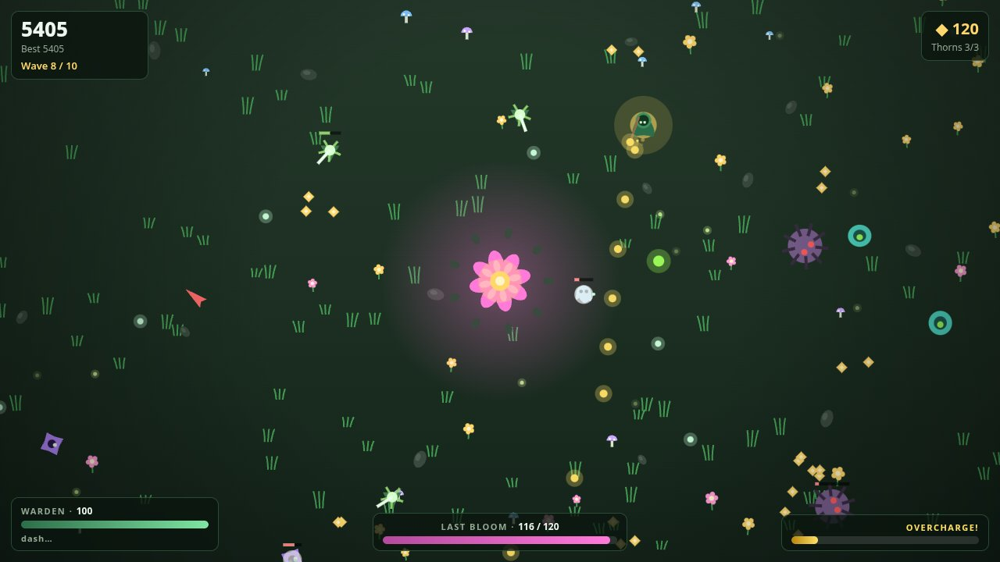

# BLOOMWARDEN — Defense of the Last Bloom

[](https://make.fun/bounty/best-game-01)
[](LICENSE)
[](#)

A twin-stick wave-defense arcade game for the make.fun **"Make the best game"**
bounty. You are the Warden. The void is coming for the garden's last flower.
Hold the centre through **10 waves** — and face the Herald twice.

Zero libraries, zero assets, fully offline. All art is procedural Canvas 2D
drawing and all sound is procedural WebAudio synthesis. No network requests,
no tracking, nothing to install: open `game/index.html` or run `node serve.ts`.



## How it plays

The **Last Bloom** stands at the garden centre with 120 HP. Enemies spawn at
the field edges and march on it; anything that reaches it bites chunks out of
its health. The Warden is the only thing between them and the flower.

- **Five enemy kinds**, each with its own speed, HP and behaviour: the drifting
  **mote**, the armoured **bramble**, the ranged **spitter**, the fast **dart**,
  and the phasing **wisp** that flickers in and out of reach.
- **The Herald**, a boss flower, arrives on waves 5 and 10: radial bullet
  bursts, summoned minions, and an enrage below 30% HP. Its health bar sits at
  the top of the screen while it lives.
- **Thorn turrets** cost 25 shards and shoot on their own — at most 3 at once.
  **Overcharge** fills as you banish enemies; trigger it for rapid fire and
  bonus damage.
- **Pickups**: shards (currency), hearts (heal the Warden), and rare **mend**
  blooms that restore the Bloom's HP.
- The Bloom slowly regrows HP after a few seconds without damage, and the
  Warden dashes through danger with brief invulnerability.

Win by clearing wave 10. Lose when the Bloom falls. Your best score is kept in
`localStorage`. Waves get denser and tougher as they go; the balance target was
a decent player winning with Bloom HP to spare, tuned against a scripted
autopilot (see *Testing* below).

## Controls

| Input | Action |
|---|---|
| WASD / arrow keys | Move |
| Mouse | Aim |
| Hold left click | Shoot |
| Space / Shift | Dash (briefly untouchable) |
| Q / E / right-click | Plant a thorn turret · 25 shards |
| F | Overcharge, when the meter is full |
| P / Esc | Pause |
| M | Mute |
| R | Restart |
| Enter / Space | Confirm on menus |

Keyboard and mouse only; no gamepad, no touch.

## Run it

```sh
# Any static file server works. The bundled one:
node serve.ts            # serves http://127.0.0.1:8901 by default
node serve.ts --port 8080
```

Or open `game/index.html` directly in a desktop browser — ES modules load
from `file://` in most browsers, but a local server is the reliable path.
Audio starts on the first click (browsers block audio before a gesture).

## File layout

```
main.ts                  hand-in program: copies game/ + screenshots/ to the
                         output dir and writes dossier.json
serve.ts                 tiny static server for local play
shots.json               the four screenshots this entry ships
vendor/makefun-game.ts   dossier builder, copied unchanged from the kit
game/
  index.html             canvas, HUD, title / pause / win / game-over screens
  src/
    config.js            every tuning number and the colour palette
    random.js            seeded RNG (mulberry32) — deterministic runs
    input.js             keyboard + mouse state, edge-triggered actions
    world.js             the simulation: warden, bloom, enemies, boss,
                         turrets, bullets, pickups, waves, particles
    render.js            procedural Canvas 2D art, screen shake, vignette
    hud.js               DOM HUD and screens, cached writes
    audio.js             procedural WebAudio synth, lazily started
    shots.js             deterministic screenshot staging + autopilot
    main.js              boot, fixed-step loop, shot mode
screenshots/             1-action.jpg, 2-title.jpg, 3-boss.jpg, 4-end.jpg
```

`world.js` has no DOM or browser dependency: the whole simulation runs
headless in Node, which is how balance was tuned.

## Screenshots

The four screenshots are real renders of this game's own code, captured in
headless Chromium at 1280×720. They are staged deterministically, never
edited:

```
?shot=title&seed=1   title screen over the idle garden
?shot=action&seed=1  wave 8 at its densest, ten enemies on screen
?shot=boss&seed=1    wave 5, the Herald on screen with its escort
?shot=end&seed=1     a doomed pilot that never shoots — the garden falls
```

Staging plays the real rules forward from the seed under a scripted pilot and
sets `window.__shotReady` when the frame is ready. No state is edited, no
pixels are faked: every staged frame is a position the game can genuinely
reach. `shots.json` lists the four shots the hand-in copies.

## Testing

- **Syntax**: `node --check` passes on all nine game modules.
- **Headless simulation** (DOM-free `world.js` + autopilot, Node): seeds 1, 2
  and 3 all **win** in 180–186 seconds, with Bloom HP 49/100/120 left, Warden
  HP 16/76/49, scores ≈ 10,750–10,850, 207–215 kills. Staged scenes verified
  in the same harness: title at wave 0; action at wave 8 with 10–11 enemies
  and 3 turrets; boss present with escort; end scene reaches game over.
- **Headless Chromium playthrough** (Playwright, SwiftShader): title visible,
  start, move, fire, dash, plant, overcharge, pause/resume, mute, restart —
  all pass, with **zero console errors, zero page errors, zero external
  requests** (10 requests, all to the local server).
- **Determinism**: the hand-in program was run twice into separate output
  dirs and the outputs compared byte-for-byte — identical.
- **Caps**: `game/` is 10 files, far under the 993-entry / 48 MiB limits;
  `index.html` is 8,453 bytes (limit 1 MiB); every screenshot is under
  256 KiB at 1280×720; the dossier is well under its size limits.

### Verification gaps, stated honestly

- Browser testing was headless/SwiftShader only — no headed or GPU run.
- Audio was verified by code inspection and by its guarded no-op behaviour
  when no audio device exists; it was never actually heard.
- Balance was tuned against a scripted autopilot, not human players. A real
  player who kites well will find it easier; a player who stands still will
  find it harder. The win screen exists and is reachable — the autopilot
  reaches it on every tested seed.

## License

MIT — see [LICENSE](LICENSE). Copyright 2026 aboys25. Original work, built by
an AI agent for the make.fun bounty. No third-party code, art, or sound.
